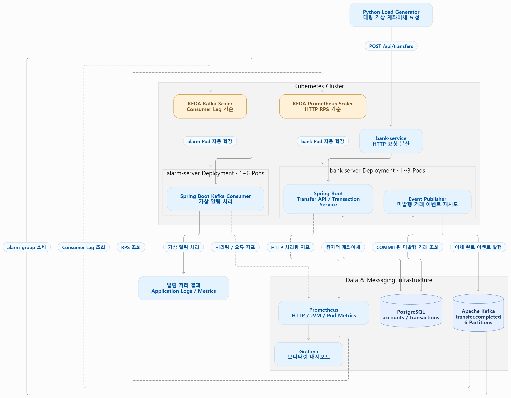
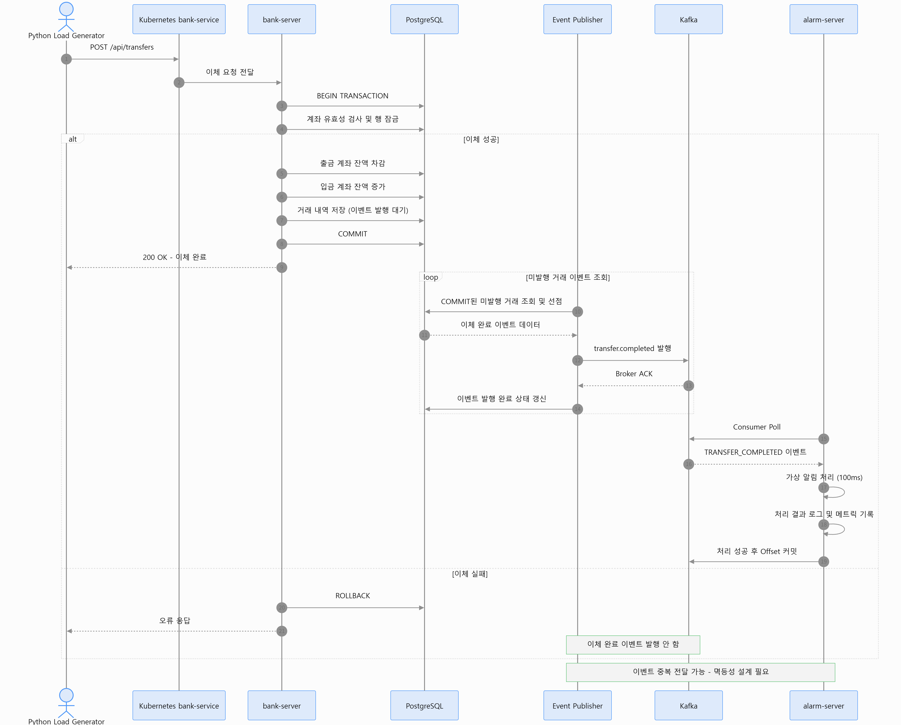
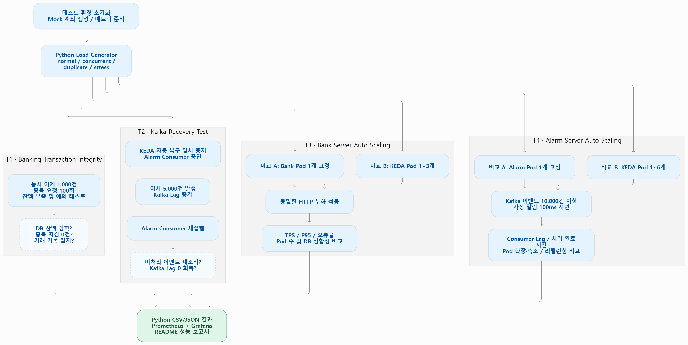

# finguard-banking-system
Kafka와 Kubernetes 기반의 금융거래 시스템으로 안전한 계좌이체, 이벤트 기반 알림 처리, 실시간 이상거래 탐지 및 마이크로서비스 자동 확장을 구현하는 프로젝트입니다.

## 1. System Architecture

## 2. Transfer Sequence Diagram

## 3. Test Plan Diagram
